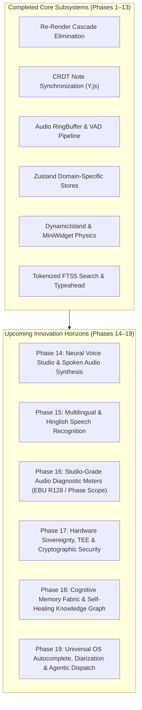

# PiyNotes / BlueArkive Master Roadmap & Audit Hub

Welcome to the centralized engineering roadmap, audit log, and upcoming innovation tracker for the **PiyNotes (BlueArkive)** ecosystem.

---

## 📊 Quick Status Summary

| Document | Scope | Status | Total Items |
| :--- | :--- | :--- | :--- |
| [improvement.md](file:///Users/piyushkumar/Desktop/1.piynoteskiro/upcoming.md/improvement.md) | Architectural Audits, Performance, UI Polish & Upcoming Frontier Phases | 🟢 **Phases 1–13 Completed (100%)** / 🚀 **Phases 14–19 Upcoming** | 45 Completed + 25 Upcoming |
| [issues.md](file:///Users/piyushkumar/Desktop/1.piynoteskiro/upcoming.md/issues.md) | Security, Memory Leaks, CSP, Race Conditions & Bug Fixes | 🟢 **100% Resolved & Verified** | 72 Resolved |

---

## 🗺️ Roadmap Architecture Overview

---

## 📂 Navigation Links
- 👉 **[Read Detailed Master Improvements & Frontier Tasks (`improvement.md`)](file:///Users/piyushkumar/Desktop/1.piynoteskiro/upcoming.md/improvement.md)**
- 👉 **[Review Complete Audit Issues & Fixes (`issues.md`)](file:///Users/piyushkumar/Desktop/1.piynoteskiro/upcoming.md/issues.md)**
